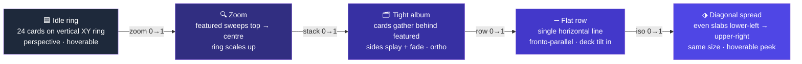
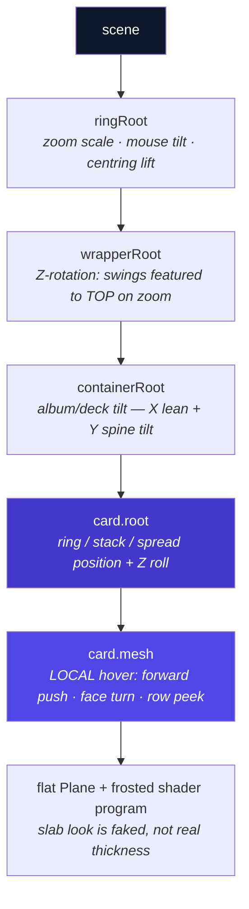
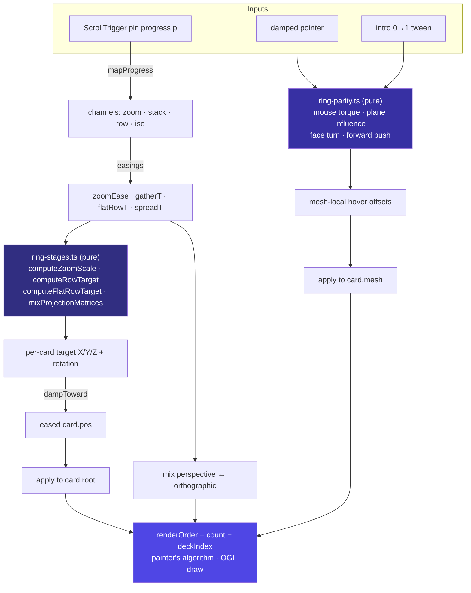
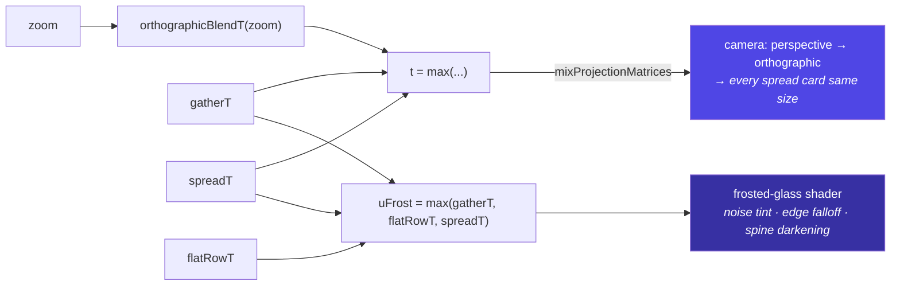

# Ring Scene — Visual Diagrams

Companion to [`ring-scene-architecture.md`](./ring-scene-architecture.md). These
Mermaid diagrams render on GitHub, in VS Code's Markdown preview, or paste them
into <https://mermaid.live> for a full-screen, exportable view (great for a deck).

---

## 1. The scroll timeline — four overlapping channels

One pinned `ScrollTrigger` maps pin-progress `p ∈ [0,1]` into four overlapping
channels. The overlap is what makes stages cross-fade instead of snapping.

```mermaid
gantt
    title Scroll progress p (0 → 1) over SCROLL_LENGTH = 3200px
    dateFormat X
    axisFormat %s

    section zoom
    ring scale · centre · splay · ortho    :z, 0, 40

    section stack
    gather into tight album                 :s, 35, 58

    section row
    tight album → flat horizontal row       :r, 54, 78

    section iso
    flat row → diagonal slab spread         :i, 74, 100
```



> Read the X axis as `p × 100`. Where bars overlap (e.g. 35–40, 54–58, 74–78),
> two stages ease simultaneously — the hand-off beats.

---

## 2. What you see, stage by stage



---

## 3. Transform hierarchy (the matrix stack)

Placement lives on `card.root`; hover offsets live on `card.mesh`. That split
keeps hover always in the card's **local** frame.



---

## 4. Per-frame update — data flow

Every frame, raw channels → easings → pure stage math → damped follow → render.



---

## 5. Camera blend & frost — what's driven by what



---

## 6. Two hovers, gated by phase

```mermaid
stateDiagram-v2
    [*] --> IdleRingHover: zoom ≈ 0
    IdleRingHover --> DeadZone: zoom rises
    DeadZone --> RowHover: iso > 0.5
    RowHover --> DeadZone: scroll back

    state IdleRingHover {
        direction LR
        ar: Ar — pure math, damped pointer
        ar2: faceY (turn to face) + forwardZ (lift)
        ar3: no spring · fades out as zoom rises
        ar --> ar2 --> ar3
    }

    state RowHover {
        direction LR
        k: spring stiffness 130 → target 2
        k2: mesh.position.x = damped · hoverSlide
        k3: sideways peek only · no reorder
        k --> k2 --> k3
    }

    note right of DeadZone
        Mid-sequence: hover suppressed
        so it never leaks into the deck
    end note
```

---

### Rendering tip

To export a single image for a slide: open <https://mermaid.live>, paste one
block, then **Actions → PNG/SVG**. For a one-page poster, GitHub renders this
whole file inline.
